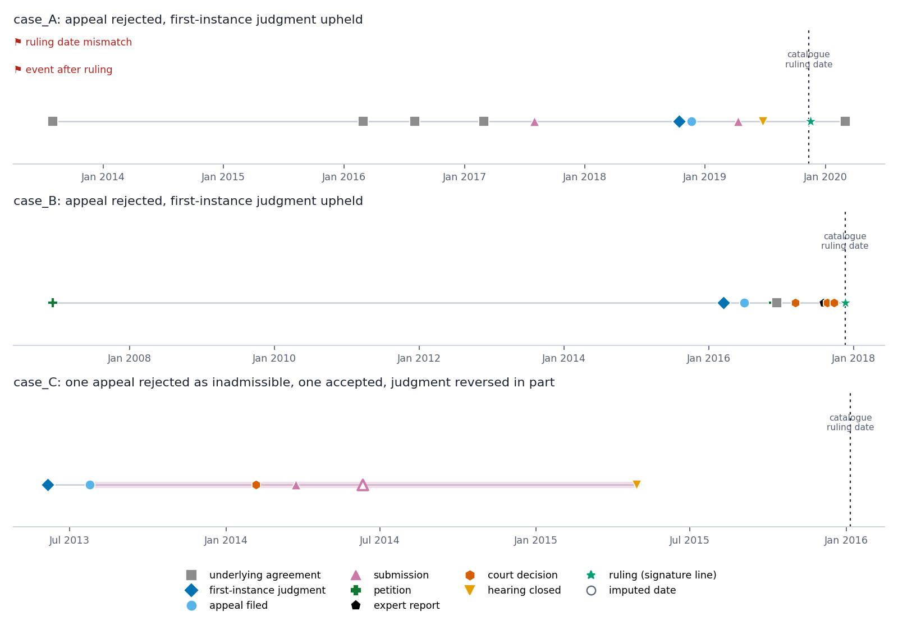
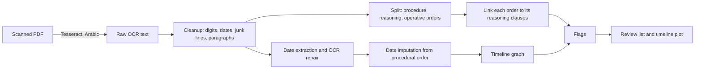

# law_coherence

**Reconstruct the timeline of a scanned Arabic appeal judgment and flag what is internally inconsistent: dates that don't add up, procedural stages out of order, orders with no matching reasoning.**

Court judgments are long, scanned and noisy. A reviewer who wants to know *"does this decision hang together?"* has to read all of it. This pipeline turns the scan into a dated event graph and a short list of review candidates.



*Three judgments, each rebuilt from OCR text. Hollow markers are dates the OCR destroyed, placed inside the interval the neighbouring stages allow. The red flags on case A come from the source text itself: the signature line and the catalogue disagree on the ruling date, and a date in the text falls after the ruling. Whether each is an OCR slip or an error in the original is for a reviewer to decide.*

## Pipeline



| Stage | Code | What it does |
|---|---|---|
| OCR | [`lawcoherence/ocr.py`](lawcoherence/ocr.py) | PDF pages to Arabic text (PyMuPDF + Tesseract) |
| Preprocessing | [`lawcoherence/preprocess.py`](lawcoherence/preprocess.py) | Unifies Arabic/Latin digits and dates, drops page numbers and stray glyphs, re-joins wrapped lines, splits the judgment into procedure, reasoning clauses and operative orders |
| Dates and imputation | [`lawcoherence/dates.py`](lawcoherence/dates.py) | Reads dated events and their kind (first-instance judgment, appeal filed, hearing closed, ...), repairs OCR year errors (`7019` to `2019`), and places unreadable dates inside the interval set by the neighbouring stages |
| Ruling-to-reasoning linking | [`lawcoherence/linking.py`](lawcoherence/linking.py) | Embeds orders and reasoning clauses (CAMeLBERT-MSA, mean-pooled, centred on the judgment's own mean) and links each order to its closest clauses |
| Timeline graph | [`lawcoherence/timeline.py`](lawcoherence/timeline.py) | `networkx` graph of events, review flags, and the timeline plot above |
| Anonymization | [`lawcoherence/anonymize.py`](lawcoherence/anonymize.py) | Name redaction and per-document date shifting, used to make the sample data |

### Flags

Flags are **review candidates, not verdicts**. Each one says what to look at and why.

| Flag | Meaning |
|---|---|
| `ruling date mismatch` | the signature line and the catalogue give different ruling dates |
| `event after ruling` | a procedural date later than the ruling |
| `out of sequence` | first-instance judgment, appeal, hearing close and ruling are not in that order |
| `order without matching reasoning` | a form or merits order whose closest reasoning clause scores below a floor |
| `imputed date` | the date was unreadable and was inferred |
| `long gap` | more than a year between two procedural stages |

## Results so far

- The pipeline has been run on about 4,500 Court of Appeal rulings (civil, criminal and press) from a public Lebanese legal database.
- Dates read from OCR and repaired were about 9 in 10 correct in a hand check.
- Survival and time-to-decision modelling on the extracted timelines is **not part of this release**.

<!-- TODO: add the C-index once the survival-analysis run is in the repo with its script and data description -->

## How to run

```bash
git clone https://github.com/olasadek/law_coherence.git
cd law_coherence
pip install -r requirements.txt
jupyter lab notebooks/demo.ipynb
```

The notebook runs the whole pipeline on the three judgments in [`data/sample/`](data/sample) and prints the flagged output.

- **CAMeLBERT needs a GPU.** On a GPU runtime (Colab, Kaggle) the notebook uses CAMeLBERT automatically. On a laptop it falls back to a TF-IDF matcher so the demo still runs. Force either with `LAW_BACKEND=camelbert` or `LAW_BACKEND=tfidf`.
- OCR from your own PDFs: `pip install -r requirements-ocr.txt`, install Tesseract with the Arabic language pack, then `from lawcoherence.ocr import ocr_pdf`.

From Python:

```python
import datetime as dt
from lawcoherence import analyse

r = analyse(open("data/sample/case_A.txt", encoding="utf-8").read(), dt.date(2019, 11, 11), "case_A", backend="tfidf")
r["flags"]     # review candidates
r["events"]    # dated events, with imputed ones marked
r["links"]     # each operative order and its closest reasoning clauses
```

## Sample data

[`data/sample/`](data/sample) holds three Court of Appeal judgments from a public Lebanese legal database, kept as raw OCR text so the cleanup stage has something to clean. They are anonymized:

- names of parties, lawyers, judges, companies and places are replaced with `[اسم]`;
- property numbers and lower-court case numbers are removed;
- every readable date is shifted by one fixed number of days per judgment, so intervals between events stay exact but the real dates are not shown.

Anonymization was done with rules plus a manual read-through; if you find anything that should not be there, open an issue.

## Limitations

- Event kinds are read from the words around a date and are approximate.
- Scans with heavy redaction blots lose many dates; imputation gives an interval and a midpoint, not the truth.
- Tuned on Lebanese Court of Appeal judgments in Arabic; other courts need new patterns.
- The linking floor in `lawcoherence/timeline.py` is a demo setting, not a tuned threshold.

## What comes next

Scoring whether each ground of appeal receives a reasoned answer in the court's reasoning (in preparation). The full corpus and trained models are not part of this repository.

## License

MIT, see [LICENSE](LICENSE).
